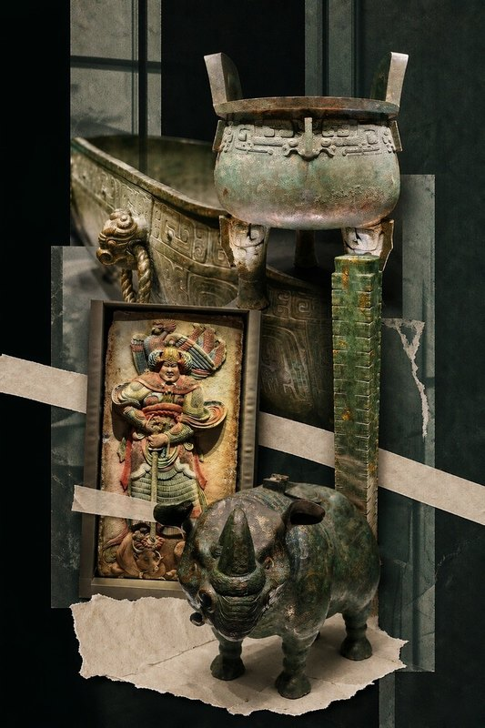
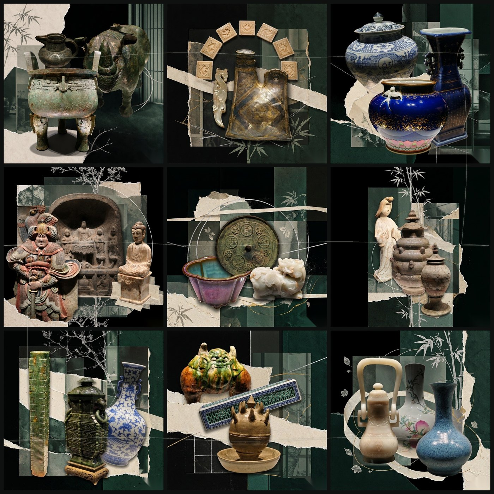
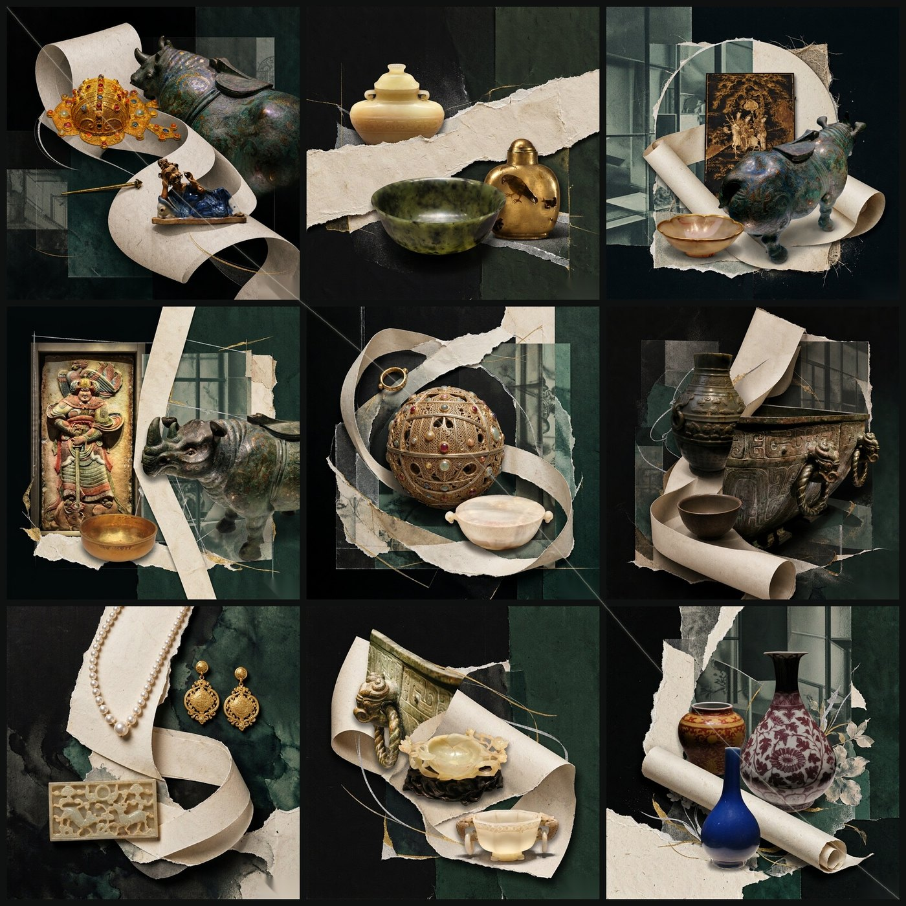
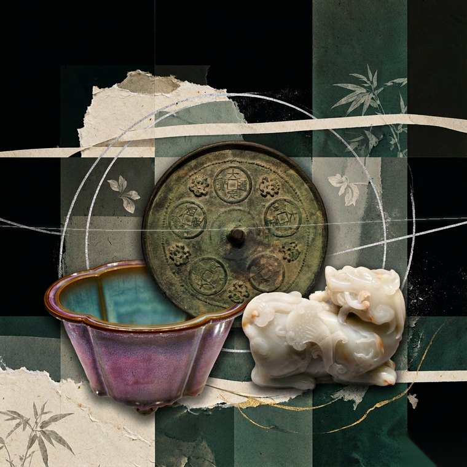

# 文物墨影拼贴 · relic-ink-collage

[](LICENSE)
[](https://www.python.org/)

把博物馆里的文物照片，重构成一张**超现实拼贴**：底层是墨黑与极深苔绿的错位窗格，中层是米白手工撕纸，上层是一条贯穿画面的纸带与银金细线。器物脱离展柜，在同一空间里相互承托、穿越、遮挡，形成有纵深的"纸上剧场"。

可以做成**单幅竖版主画面**，也可以扩成**三行三列九宫格**——九格各自能独立观看，拼合后动线与元素跨格连续。

这是一个为 AI Agent 编写的 **Skill**（技能包），不是独立 App。它把"怎么做"写成了可执行的流程：视觉语法、动线参数、提示词模板，加上三个真正能跑的脚本。



## 效果

九宫格不是九张拼图凑在一起，而是一套跨格动线系统。下面两套都是九张 `1024×1024` 单图拼合的结果：

| 墨影窗格 · 横贯动线 | 长卷回旋 · 斜卷动线 |
| --- | --- |
|  |  |

单格放大后仍可独立成立——这是判断"真九宫格"还是"伪九宫格"的标准：



## 它解决什么问题

直接把五张文物照片丢给图像模型，通常得到两种结果：五件东西并排站队，或者模型自由发挥、器物被改得面目全非。

这个技能约束的是**两者的中间地带**——构图必须戏剧化、超现实，但器物的形制、纹样、锈色、残损必须还原。为此它规定了六条视觉语法：

1. **底色**：深墨黑 `#0c0d0d` 到极深苔绿 `#101a15`，大面积负空间。禁止中灰、米色或彩色铺底。
2. **窗格与切片**：错位的竖向窗框与灰绿摄影切片，像旧窗与底片残片。只做秩序背景，不做等分蒙德里安网格。
3. **撕纸**：米白手工纸、旧纸纤维、毛边。撕纸承担"地面"，器物落在纸上而不是悬浮。
4. **纸带**：一条**连续**的米白长纸带作为主动线，穿行、绕过、托起器物。可以前后遮挡，但不能断成数截。
5. **细线**：银白与暗金发丝线，只做节奏。不织成蛛网，不盖住纹样。
6. **器物锚定**：每件器物来自真实来源照片，不新增、不合并、不重绘纹样。

改动其中两条以上，画面就不再属于这个系列。

## 核心方法：先定动线，再排器物

这是整个技能里最容易被忽略、也最决定成败的一步。顺序颠倒就会退化成"三件物品排排坐"。

| 结构 | 路径 | 适合 |
| --- | --- | --- |
| 竖通 | 纸带自顶边某宽度进入、同宽度离开 | 单列叙事、造像与长瓶 |
| 横贯 | 纸带自左边某高度进入、右边某高度离开 | 单幅与三列并置 |
| 斜卷 | 纸带从左上盘旋到右下逐渐收细 | 九宫格通铺 |

九宫格还要做**边界成对约定**：左格写"右边 32% 高度离开"，右格就必须写"左边 32% 高度进入"。数字不一致，拼合后必然错位。完整参数表见 [references/grid-choreography.md](references/grid-choreography.md)。

## 安装

技能包遵循 Agent Skill 的目录约定，克隆后直接放进技能目录即可。

```bash
# 用户级（所有项目可用）
git clone https://github.com/qingqijiete/relic-ink-collage.git \
  ~/.workbuddy/skills/relic-ink-collage

# 项目级（仅当前项目）
git clone https://github.com/qingqijiete/relic-ink-collage.git \
  .workbuddy/skills/relic-ink-collage
```

Windows 路径为 `C:\Users\<name>\.workbuddy\skills\relic-ink-collage`。

脚本依赖：

```bash
python -m pip install -r requirements.txt
```

装好后新开一个对话让它加载，然后上传文物照片并说：

> 用 relic-ink-collage 把这五张做成墨影拼贴

## 目录结构

```
relic-ink-collage/
├── SKILL.md                        主流程：视觉语法、八步工作流、护栏
├── references/
│   ├── style-system.md             色彩表、五层纵深、常见失败模式对照
│   ├── prompt-recipes.md           单幅 / 九宫格 / 素材板三套提示词模板
│   └── grid-choreography.md        三种动线 + 九格边界参数表 + 衔接检查表
├── scripts/
│   ├── make_refboard.py            多图裁切排成素材板
│   ├── clean_corner.py             角落水印修补，带 --check 自检
│   └── assemble_grid.py            九格拼合 + 贯穿动线 + 批量清角标
├── docs/                           README 用示例图
└── requirements.txt
```

## 脚本

三个脚本都可以脱离 Agent 单独使用。

**素材板**——图像生成服务通常一次只收 3 张输入图。超过 3 件器物时，先把它们裁切排成一张板：

```bash
python scripts/make_refboard.py --out refboard.jpg \
  --crop 0.02,0.00,0.98,0.95 a.jpg \
  --crop 0.00,0.00,1.00,1.00 b.png \
  --crop 0.26,0.02,0.74,0.94 c.png
```

支持 1–9 张的自动排版（5 张排 3+2 这类）。裁切比例建议目视确认：主体完整、不留展台和地面。

**清角标**：

```bash
python scripts/clean_corner.py --image panel.png --out panel_clean.png --check check.jpg
```

**九格拼合**（自动取每个目录里最新的图，可叠加贯穿动线）：

```bash
python scripts/assemble_grid.py --out grid.png \
  --panel-dirs 01 02 03 04 05 06 07 08 09 \
  --cell 1024 --guide diagonal --clean
```

## 已知限制

- **浅色纸面上的白色水印清不掉。** `clean_corner.py` 靠亮度阈值分离深色底上的角标；当水印是半透明白字压在米白纸面上，纸纤维纹理的干扰会让阈值、局部残差、顶帽变换全部失效。正确做法是构图阶段预防：提示词里要求"右下角保持大面积深色负空间"，让角标落在暗底上。清理后务必看 `--check` 输出，不要假设成功。
- **它不做文物鉴定。** 本技能不推断年代、产地、馆藏号，也不补全残缺纹样。所有形制信息必须来自来源照片。
- **九宫格会消耗更多生成额度。** 九格通常需要 9–15 次生成（含返修），先跑中央格校准风格再批量生成能省下不少。

## 参与贡献

四类贡献都有对应的 issue 模板，点 [New issue](https://github.com/qingqijiete/relic-ink-collage/issues/new/choose) 直接选：

- **画面失败模式** —— 生成结果出了问题，带上提示词与成品图
- **新动线提案** —— 新的纸带结构，需附九格边界参数与实测成品
- **脚本问题或需求** —— 三个脚本的 bug、兼容性、新能力
- **提示词模板改进** —— 针对特定器物类型的约束句

细则见 [CONTRIBUTING.md](CONTRIBUTING.md)。

## 许可

[MIT](LICENSE) © 2026 清奇杰特

示例图使用作者本人拍摄的博物馆照片制作，仅用于展示效果。

`SKILL.md` 中提到的 `five-relic-color-collage` 是另一个独立技能（固定五张来源图、红黄蓝高纯度配色、顶部保留来源图带），**不在本仓库内**，其许可与本项目无关。

---

## English

A skill for recomposing museum artifact photographs into connected surreal collages: ink-black and moss-green offset window panes, rice-paper torn edges, and a single continuous paper ribbon that carries objects across cell borders. Works as a single 2:3 hero piece or a 3×3 grid where each cell stands alone and the whole reads as one composition.

The method is deliberately constrained: pick the ribbon path **before** placing objects, keep artifacts faithful to their source photographs, and never invent inscriptions. Ships with three standalone scripts for building multi-image reference boards, assembling grids with a bezier guide, and inpainting burned-in corner badges.

Licensed MIT. Built for AI agents, useful to humans too.
